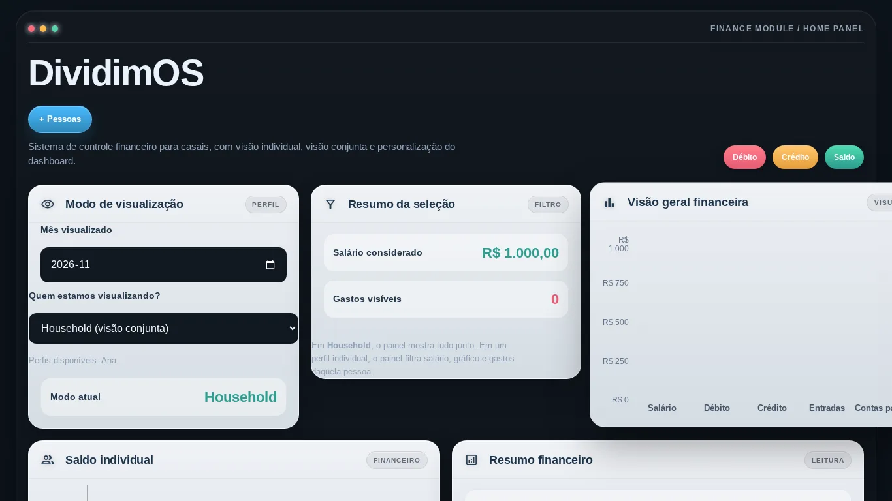
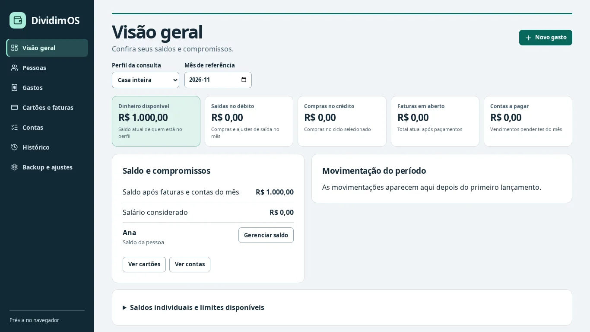
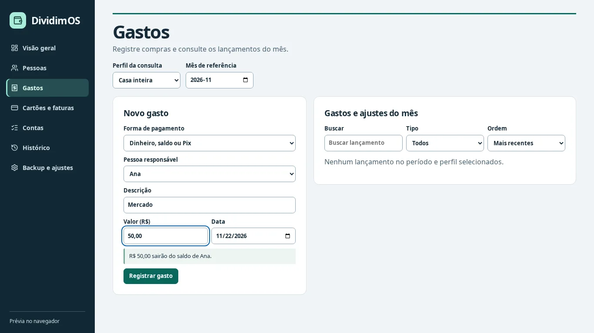

> Atualização 11/11/2026: aluno optou por entrega individual; aceitação pelo professor pendente. Registro abaixo preserva o estado histórico de outubro. Consulte README e relatório de novembro para a situação atual.

# Evidências reais — DividimOS Offline

Integrante 1: Daniel Barros de Deus. Integrante 2: PENDENTE (nome, contribuição e revisão reais).

## Código e colaboração
- Repositório: https://github.com/DanielBDeDeus/dividimos-offline
- Implementação isolada: https://github.com/DanielBDeDeus/dividimos-offline/pull/1
- Demonstração controlada: https://github.com/DanielBDeDeus/dividimos-offline/pull/2
- O histórico original foi importado. Nenhum dos PRs prova participação de outro aluno.

## CI vermelha e verde — demonstração controlada concluída
- Vermelha: https://github.com/DanielBDeDeus/dividimos-offline/actions/runs/40994472015
- Commit vermelho: 4533eb208a84f28635ef6231c99bd7b4f0f58a5a.
- Causa deliberada: calcularSaldoDisponivel(100, 20, 30) devolve corretamente 50, mas o teste exigia -999. Vitest: 1 falha e 8 aprovados; API/build/scan bloqueados.
- Correção: expectativa alterada para 50 no commit 60d03fdc32374f803d573af26bf7cfd8a51300d8; cálculo de produção inalterado.
- Verde: https://github.com/DanielBDeDeus/dividimos-offline/actions/runs/40994594705
- Resultado: 9 Vitest + 11 API/SQLite, build e Trivy concluídos.

## Candidato de entrega
- Código exato: 981530f32e7b3706e334feab0590198a577139db.
- CI aprovada: https://github.com/DanielBDeDeus/dividimos-offline/actions/runs/40906674077
- Builds Windows/Linux: https://github.com/DanielBDeDeus/dividimos-offline/actions/runs/40906663600
- Rascunho de release (acesso do proprietário): https://github.com/DanielBDeDeus/dividimos-offline/releases/tag/untagged-ba153c9d8ebb49e8814e
- Assets: DividimOS-1.0.0-Portable.exe (114409661 bytes), DividimOS-1.0.0-x86_64.AppImage (129859658 bytes), SHA256SUMS.txt.
- Windows Electron: startup, isolamento do preload, persistência/reabertura, exportação/importação/cancelamento e rejeição de JSON inválido passaram. Requisições externas do renderer bloqueadas. Seletores nativos simulados: não equivale a teste manual do EXE portátil.
- Trivy: relatório real no artefato trivy-security-report da CI; package-lock.json teve zero achados no filtro HIGH/CRITICAL. Secrets indicado como '-' (não escaneado nesse alvo); report-only não bloqueia entrega por vulnerabilidade.

## Falhas adicionais verificadas
- https://github.com/DanielBDeDeus/dividimos-offline/actions/runs/40687726038: tag inexistente do Trivy impedia setup; corrigida para v0.36.0 fixada por SHA.
- https://github.com/DanielBDeDeus/dividimos-offline/actions/runs/40905978541: configuração do teste iniciava Electron em modo Node; remoção de ELECTRON_RUN_AS_NODE corrigiu o teste.

## Pendente — não declarar concluído
- Aprovação/publicação da release e merge após revisão.
- Execução do EXE sem admin e do AppImage no Bazzite; teste com rede fisicamente desligada; operações CRUD completas; seletores de backup; upgrade/rollback reais.
- Identidade e contribuição real do segundo estudante; apresentação por ambos; duas submissões individuais no Moodle.

## Revisão de interface e cotação

A v1.0.0 concentrava filtros e tarefas numa página e exibia “Erro” na cotação. A revisão usa telas por tarefa com navegação persistente. O formulário de gastos pede primeiro a forma de pagamento e mostra o impacto no saldo ou na fatura. A tabela de histórico tem busca, filtros e ordem. As capturas usam dados fictícios no Chromium com frontends de produção servidos pela API local, a 1366 × 768.

| Visão geral v1.0.0 | Visão geral em revisão |
| --- | --- |
|  |  |

### Referências aplicadas

- A navegação usa rótulos de tarefa e indicação da página atual, seguindo o Fluent 2 e o princípio de reconhecimento do Nielsen Norman Group. [Fluent 2](https://fluent2.microsoft.design/components/web/react/core/nav/usage) · [NN/g](https://www.nngroup.com/articles/ten-usability-heuristics/)
- Os formulários usam rótulos persistentes, campos condicionais e mensagens junto à ação. Histórico usa busca e filtros visíveis. [Carbon Forms](https://www.carbondesignsystem.com/building-blocks/core/patterns/forms) · [Carbon Data Table](https://www.carbondesignsystem.com/building-blocks/core/components/data-table/guidelines) · [Actual Budget](https://actualbudget.org/docs/transactions/filters/)
- A interface usa foco visível, nomes acessíveis, alvos maiores que 24 px nos controles principais e uma tabela de valores alternativa ao gráfico. Isso cobre verificações selecionadas, sem alegação de conformidade integral. [WCAG 2.2](https://www.w3.org/TR/WCAG22/)
- A consulta usa a cotação oficial de venda mais recente disponível no período consultado, a pedido do usuário. [Banco Central, dados abertos PTAX](https://dadosabertos.bcb.gov.br/dataset/dolar-americano-usd-todos-os-boletins-diarios)

### Verificação

- Testes locais de unidade e API/SQLite cobrem débito, crédito, pagamento parcial, edição/exclusão, fechamento de fatura, formato brasileiro e cache de PTAX com sucesso, falha, timeout e dados inválidos.
- Chromium executou o fluxo de cadastro, gasto sem cartão, crédito, pagamento de fatura, ajuste, conta paga, edição/exclusão, filtros e recarga. Foram verificadas sete telas em cada tamanho de janela 960 × 600, 1366 × 768 e 1920 × 1080, além de foco visível com Tab.
- O smoke do Electron no workflow usa um perfil descartável, bloqueia a rede externa do renderer, simula a PTAX e os diálogos de arquivo e verifica uma carga de dados financeiros legados. Consulte o run do commit para o resultado.
- O esquema de SQLite e as chaves de backup permanecem compatíveis. Cada operação financeira grava um estado consolidado. Os dados de pessoas reais ficam fora da verificação.
- Permanecem os testes físicos de execução sem admin, rede desconectada, seleção nativa de arquivos e upgrade/rollback entre portáteis.
